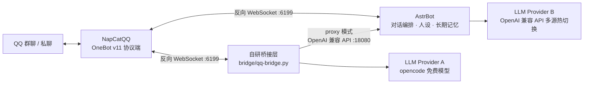

# qq-agent-bot

基于 **AstrBot + NapCatQQ + OpenAI 兼容 API** 的 QQ 群聊 AI 机器人，含自研多 Provider 桥接层。2026.05 起稳定运行 3 个月，基于 319+ 条真实对话 badcase 持续迭代提示词与人设。

> 正在升级为「RAG 知识库问答 + FastAPI 服务化 + Docker 容器化」的完整 Agent 项目，见文末 Roadmap。

## 架构



**双链路设计**：

- **AstrBot 链路**（主力）：NapCatQQ 反向 WS → AstrBot（人设、长期记忆、唤醒词）→ OpenAI 兼容 API。多 Provider 热切换成本 0（直连 / 代理双通道）
- **桥接直连链**（省成本）：NapCatQQ 反向 WS → 自研 `qq-bridge.py` → opencode 免费模型；也可切到 `proxy` 模式，把自己伪装成 OpenAI 兼容 API 供 AstrBot 当作一个 Provider 调用

## 核心特性

- **RAG 知识库问答**：Chroma + bge-large-zh 向量检索，AstrBot 插件非侵入接入（命中注入、未命中放行、异常降级），30 问评测 76.7%
- 多 Provider 热切换：直连 / 代理双通道，运行期切换成本 0（当前主力 DeepSeek V4.1 Flash 官网直连）
- 桥接层 3 种 Provider（opencode / Moonshot / Anthropic）× 2 种模式（direct / proxy）
- 人设与长期记忆：system prompt 指令体系
- 319+ 条真实对话 badcase 驱动的提示词迭代
- Windows 自启脚本：端口探活（6185 / 6199）、僵尸进程清理、日志 UTF-8 编码处理

## 快速开始

前置依赖：Python 3.12+、NapCatQQ Desktop；AstrBot 链路另需 [AstrBot](https://github.com/AstrBotDevs/AstrBot) v4.25+

```bash
git clone <repo-url>
cd qq-agent-bot
pip install websockets httpx
cp .env.example .env        # Windows: copy .env.example .env
# 编辑 .env，按所选 Provider 填入 API key
python bridge/qq-bridge.py                      # direct 模式直连 NapCat
# BRIDGE_MODE=proxy python bridge/qq-bridge.py  # 或 proxy 模式
```

NapCatQQ 侧需配置反向 WebSocket 指向 `ws://<本机IP>:6199`。

Windows 一键启动（脚本内含本机路径，换机器需调整）：

- `scripts/start-bridge.ps1` —— 桥接直连链
- `scripts/start-astrbot.ps1` —— AstrBot 链路

## 项目结构

```
qq-agent-bot/
├── bridge/                    # 自研桥接层
│   ├── qq-bridge.py           # 主力：3 Provider × 2 模式
│   └── qq-opencode-bridge.py  # 早期版本（演进记录）
├── knowledge/                 # RAG 知识库源文件（入库；每条一主题，已脱敏）
├── rag/                       # RAG 管线（ingest 入库 / retrieve 检索）
├── scripts/                   # Windows 启动脚本
├── .env.example               # 环境变量模板
└── .gitignore
```

## Roadmap

- [x] 阶段 0：Git 入库 + 项目规范化
- [x] RAG 知识库问答（Chroma + bge Embedding，AstrBot 插件接入；30 问评测 76.7%，badcase 驱动两轮迭代 56.7% → 76.7%）
- [ ] Agent 工作流复刻与对比（Dify）
- [ ] FastAPI 服务化 + Docker 容器化
- [ ] 对话数据入库与 SQL badcase 分析
- [ ] Python 工程化重构（src/ 结构、类型注解、统一日志）
